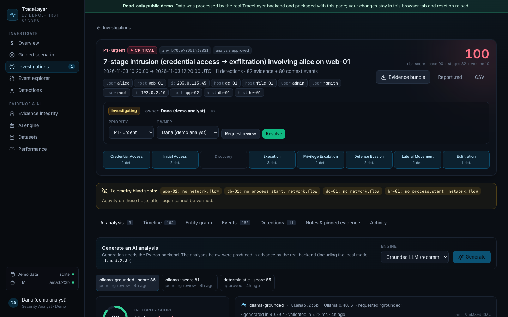
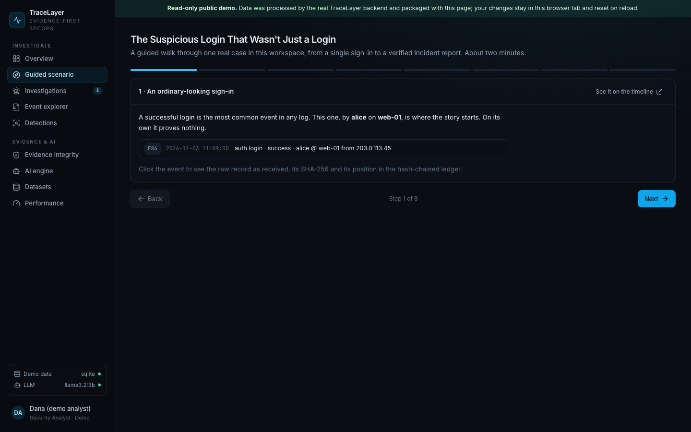
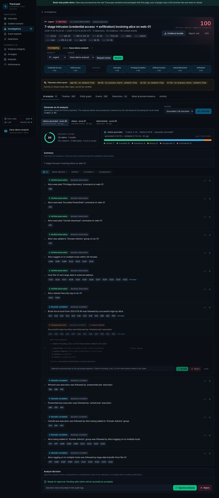
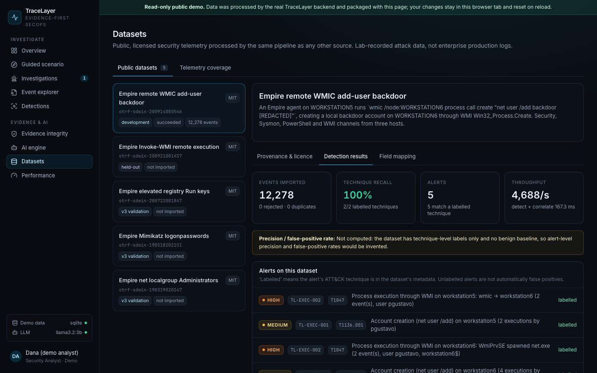
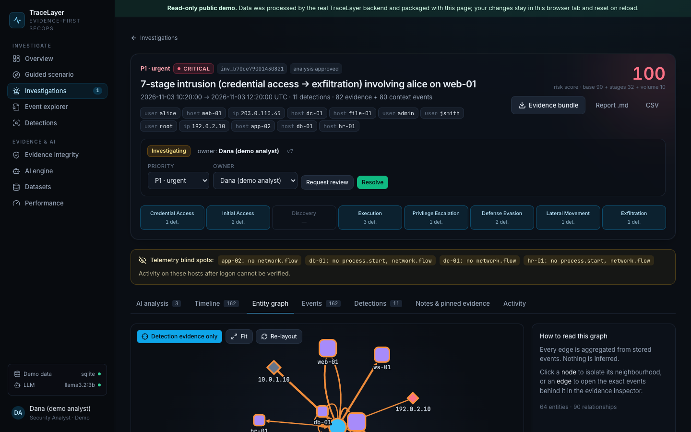
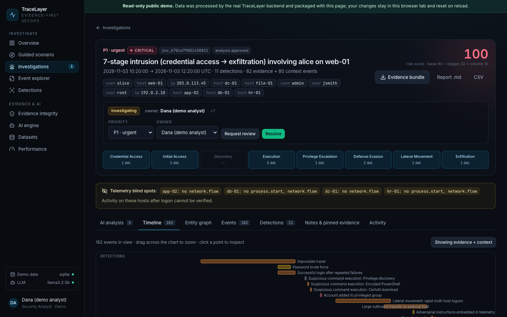
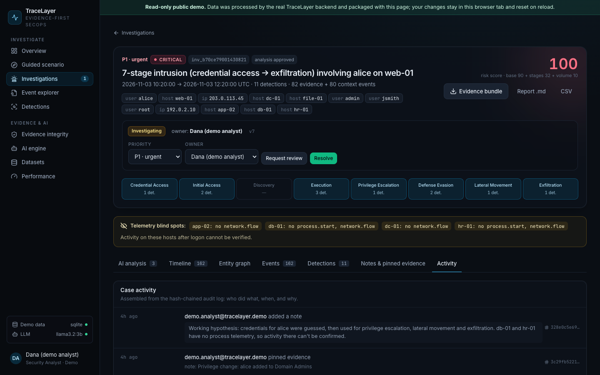

# TraceLayer

**A security investigation platform where AI has to prove what it says.**

TraceLayer ingests security telemetry into a tamper-evident ledger, detects and correlates attacker
activity into cases, and lets analysts work those cases together. It also lets an AI (a local LLM or a
deterministic analyst) draft the investigation, **then checks every sentence against the events it cites**.
Fabricated citations, invented hosts, wrong times, inflated counts, homoglyph identities and "this was just
maintenance" dismissals are caught, explained, and block approval until a human decides.

Runs entirely on a laptop. **No paid APIs, no cloud bill, no credit card.**



## The problem

Small local models write fluent incident reports, and much of what they write is wrong. In TraceLayer's
benchmark, `llama3.2:3b` produced schema-valid JSON in **15/15** runs, yet **57%** of its claims were
unsupported or contradicted by the evidence. Analysts cannot re-check every sentence by hand.
TraceLayer does it deterministically, in about 0.14 ms per claim, and shows its reasoning.

## Highlights

- **Evidence Integrity Engine.** Six verdicts per claim with reasons and a stage trace. On a frozen 40-case
  adversarial held-out set, v2 scores **97.5%** with **0 dangerous false verifications** (v1 engine: 62.5%,
  5). [Evaluation →](docs/AI_EVALUATION.md)
- **Real telemetry.** A complete adapter for OTRF Security-Datasets (Windows Security, Sysmon, PowerShell;
  MIT). It found a timezone trap, credentials in logs and a mislabelled rule, and a held-out attack dataset
  was then detected. [Findings →](docs/REAL_WORLD_DATA_EVALUATION.md)
- **Multi-user and secure by default.** Argon2id accounts, HttpOnly server-side sessions, CSRF tokens,
  three roles, and a test that checks **all 79 API routes × every role**. [Auth →](docs/AUTHENTICATION.md)
- **Case management.** New → Triaged → Investigating → Awaiting review → Resolved → Closed, with reasons,
  owner and reviewer (segregation of duties), notes, pinned evidence and optimistic locking.
- **Tamper-evident evidence.** SHA-256 per record, Merkle roots, a hash-chained ledger and audit log;
  PostgreSQL itself refuses to UPDATE or DELETE evidence from the app's role; exported bundles verify with
  a ~70-line standard-library script.
- **Local LLM, honestly labelled.** Ollama + llama3.2:3b, with the model digest, version, latency and
  JSON validity recorded on every analysis. Fallbacks are labelled, never silent.
- **Free public demo.** A static, backend-free build that replays real recorded API responses and enforces
  the same workflow rules in the browser.

| Guided scenario | Evidence verification | Real dataset results |
|---|---|---|
|  |  |  |
| **Entity graph** | **Timeline** | **Case activity (hash-chained)** |
|  |  |  |

## Try it

**Public demo:** not published yet (see [DEPLOYMENT.md](docs/DEPLOYMENT.md) to publish it on GitHub Pages
for free). Locally: `cd frontend && npm run build:demo && VITE_DEMO=1 npx vite preview`, then
choose **Start the guided scenario**: *"The Suspicious Login That Wasn't Just a Login"*, eight steps, about two minutes.

**Full application (Docker):**

```bash
cp .env.example .env               # set two database passwords
docker compose up --build -d       # http://localhost:8080
make create-admin                  # first administrator (prompts for a password)
```

Then go to **Ingest → Generate, ingest & detect**, or **Datasets → Import & evaluate**.

**Local development (SQLite, hot reload):** `make setup`, `make create-admin-local`, then `make dev-api`
and `make dev-ui` (http://localhost:5173).

**Optional local LLM:** `brew install ollama && ollama serve & ollama pull llama3.2:3b` (~2 GB; run it
natively so it can use the Apple GPU). Without it, everything works with the deterministic analyst.

## Architecture

```
React + TS (Vite) ──/api──► nginx ──► FastAPI (auth · RBAC · cases · ingest · datasets · detection ·
       │                              correlation · AI + Evidence Integrity Engine · audit · export)
       └─ demo transport (static build, no backend)          │
                                     PostgreSQL 16 (least-privilege role) / SQLite · Ollama (optional)
```

A modular monolith: one FastAPI process, a thread-pool job runner, no Redis, Celery or Elasticsearch.
[Architecture and decisions →](docs/ARCHITECTURE.md)

**Stack:** Python 3.12, FastAPI, SQLAlchemy 2, Alembic, Pydantic, argon2-cffi · PostgreSQL 16 / SQLite ·
React 18, TypeScript, Vite, Tailwind, TanStack Query, Cytoscape.js, Recharts · Ollama · pytest, vitest,
Playwright · Docker Compose · GitHub Actions.

## Measured results

| | Result | Source |
|---|---|---|
| Ingest, 100k events | **23,904/s** SQLite · **16,728–17,273/s** PostgreSQL (warm) | [PERFORMANCE.md](docs/PERFORMANCE.md) |
| Detection, 100k events | ~119k events/s; **100% rule recall, 0 false positives** (11 rules) | same |
| Claim validation | p50 **0.14 ms**, p95 0.26 ms | [AI_EVALUATION.md](docs/AI_EVALUATION.md) |
| Held-out adversarial claims (40) | **97.5%**, 0 false verifications, 0 false rejections (official run) | same |
| Real lab telemetry (OTRF) | 18,661 events, 0 rejected; held-out technique detected (1/1) | [REAL_WORLD_DATA_EVALUATION.md](docs/REAL_WORLD_DATA_EVALUATION.md) |
| llama3.2:3b vs deterministic | 18.6 s vs 1 ms; 57% vs 0% unsafe claims; 0 invalid JSON | [AI_EVALUATION.md](docs/AI_EVALUATION.md) |

## Testing

```bash
make test      # 110 backend tests (pytest) + 10 frontend unit tests (vitest)
make e2e       # 8 Playwright tests against the real API; plus 5 on the static demo (see Makefile)
make lint      # ruff, mypy, tsc --strict
make eval      # integrity evaluation: dev, regression, dev v2, frozen held-out v2
make bench     # 100k-event pipeline benchmark
make secrets-scan audit-deps   # gitleaks, pip-audit, npm audit
```

CI (GitHub Actions, free for public repositories) runs all of the above plus a PostgreSQL job that checks
migrations and database privileges.

## Security design

Server-side sessions and permissions on every route; per-session CSRF; uniform login errors and rate limits;
segregation of duties for case review; strict CSP and headers; sanitised errors; escaped exports; safe,
hash-pinned dataset import; database-enforced evidence immutability; non-root, read-only containers;
hash-pinned dependencies and SHA-pinned CI actions. Hash chains are **tamper-evident, not tamper-proof**.
[Security design →](docs/SECURITY.md) · [Audit findings →](docs/V2_SECURITY_AUDIT.md)

## Known limitations

Lab and synthetic data only, so there is no real-network false-positive rate. The rule-based claim parser
fails safe but rejects unfamiliar phrasing. A 3B model is slow and often wrong. There is no MFA or SSO, and
it runs on a single node. The public artifact is a read-only demo, because no free host keeps a database.
[Full list →](docs/LIMITATIONS.md)

## Documentation

| | |
|---|---|
| [FEATURE_GUIDE](docs/FEATURE_GUIDE.md) | every feature: what, where, why, tests, how to explain it |
| [ARCHITECTURE](docs/ARCHITECTURE.md) | data flow, module map, design decisions |
| [AUTHENTICATION](docs/AUTHENTICATION.md) · [SECURITY](docs/SECURITY.md) · [V2_SECURITY_AUDIT](docs/V2_SECURITY_AUDIT.md) | access control, threat model, findings |
| [AI_EVALUATION](docs/AI_EVALUATION.md) · [EVIDENCE_INTEGRITY](docs/EVIDENCE_INTEGRITY.md) | engine design and measured results, LLM benchmark |
| [REAL_WORLD_DATA_EVALUATION](docs/REAL_WORLD_DATA_EVALUATION.md) | public dataset selection, adapter, detection results |
| [PERFORMANCE](docs/PERFORMANCE.md) · [DEPLOYMENT](docs/DEPLOYMENT.md) · [ZERO_COST](docs/ZERO_COST.md) | benchmarks, hosting options, $0 verification |
| [LIMITATIONS](docs/LIMITATIONS.md) · [PORTFOLIO](docs/PORTFOLIO.md) | what's missing; resume bullets and interview notes |

## Data and licences

Synthetic data is generated by TraceLayer. Public telemetry: OTRF Security-Datasets, MIT License,
© 2021 Open Threat Research Forge. TraceLayer itself is MIT-licensed.
