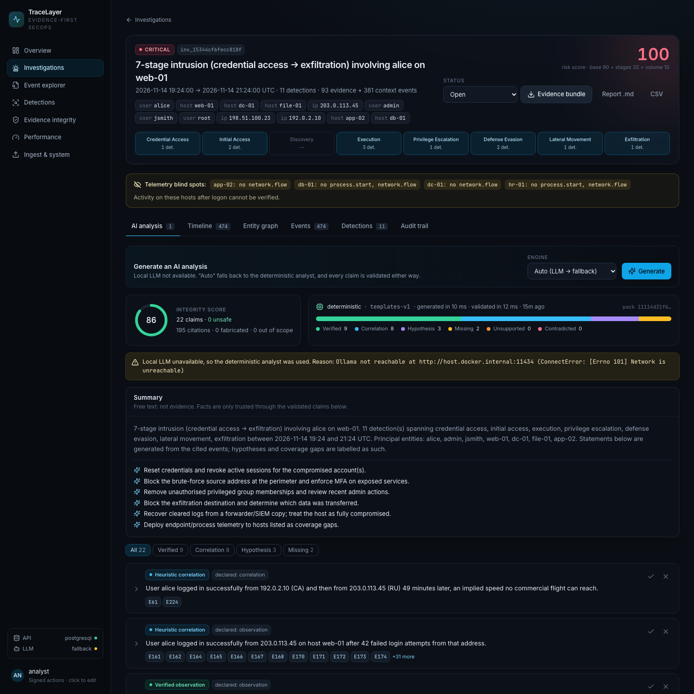
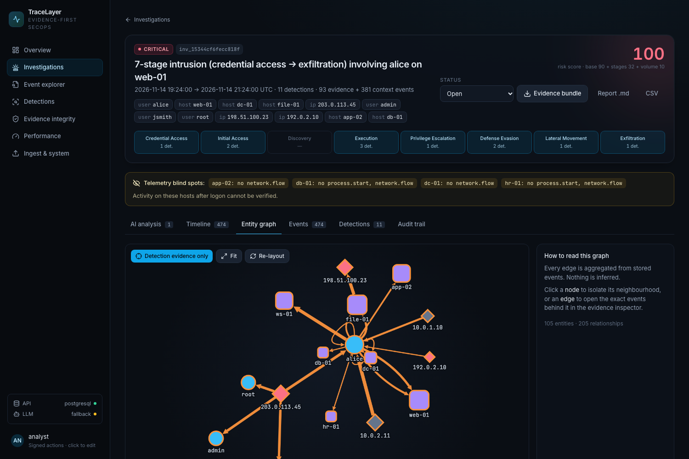
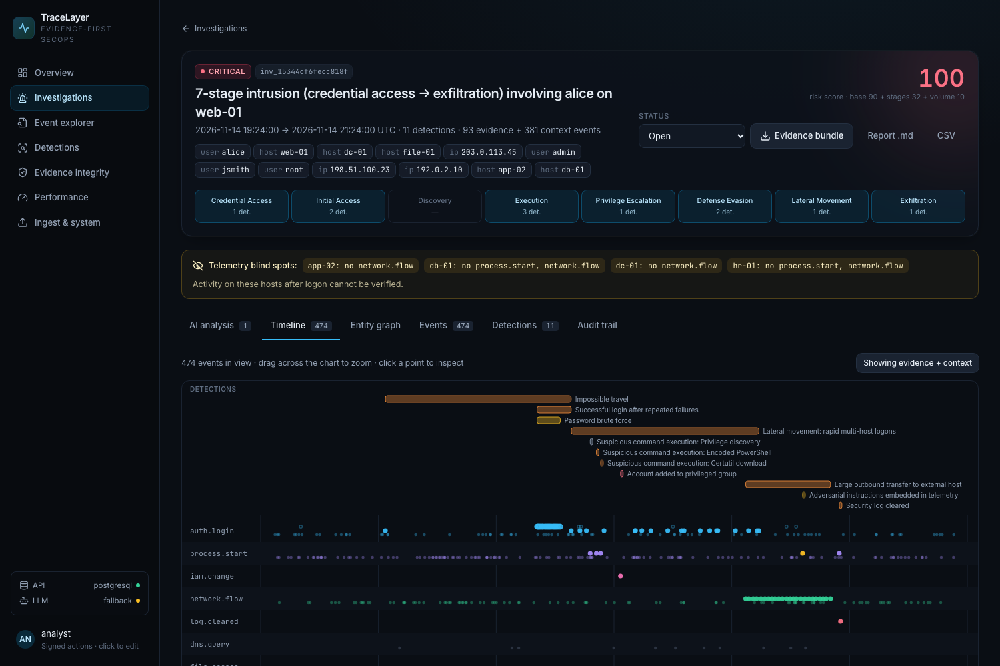
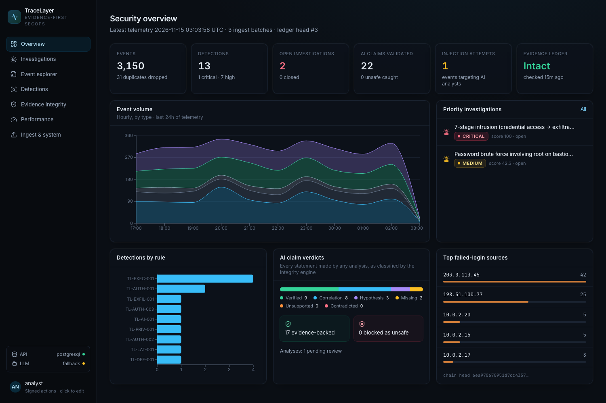
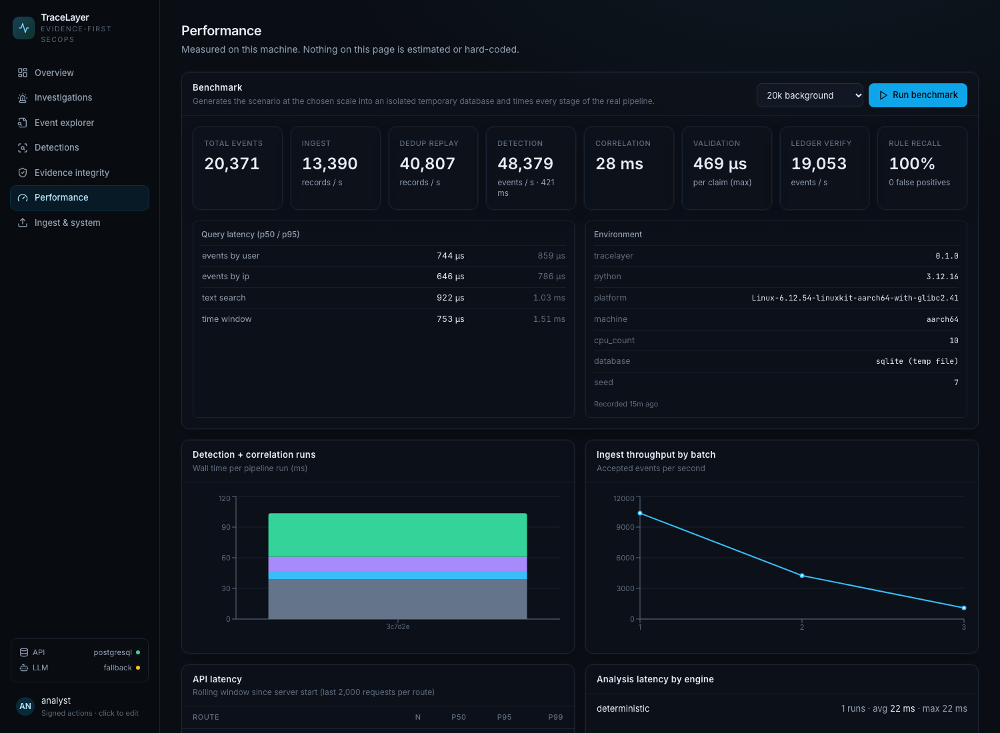

# TraceLayer

**An evidence-driven security investigation platform where AI has to prove what it says.**

TraceLayer ingests security telemetry, detects and correlates attacker activity into investigations, and lets an AI (a local LLM, or a deterministic fallback) write the analysis. Then it **checks every sentence against the evidence it cites**. Fabricated citations, invented IPs, inflated counts, reversed timelines, misattributed actions and prompt-injected "this is benign" conclusions are caught, labelled, and block approval until an analyst deals with them.

Runs entirely on a laptop. **No paid APIs, no cloud, no API keys, no credit card.**



## Highlights

- **Evidence Integrity Engine.** Six verdicts per claim: verified observation · heuristic correlation · AI hypothesis · missing evidence · unsupported · contradictory. Every verdict comes with reasons. [How it works →](docs/EVIDENCE_INTEGRITY.md)
- **Adversarially evaluated.** 47 labelled cases (31 hostile), 16 held-out paraphrases, and 13 malformed-output checks. **0 unsafe acceptances on both sets.** The held-out set found a real flaw, which was fixed with a general rule. [Results →](docs/EVIDENCE_INTEGRITY.md#3-evaluation)
- **Tamper-evident evidence.** SHA-256 per raw record, Merkle root per ingest batch, and a hash chain across batches. Verification *re-runs the parsers* to prove normalised fields weren't edited. Analyst decisions are hash-chained too.
- **Real detection and correlation.** 9 ATT&CK-mapped rules with O(n) sliding windows, and union-find correlation with ubiquitous-entity suppression and explainable risk scores. At 100k events: **100% rule recall, 0 false positives.**
- **Prompt-injection aware.** Attacker text planted in logs is tagged at ingest, quoted and flagged in prompts, and any conclusion built on it is rejected by the validator.
- **Analyst workflow.** Claim-by-claim review; approval is blocked server-side while unsafe claims are pending; overriding the engine requires a written justification.
- **Self-verifying exports.** A ZIP evidence bundle with a hash manifest; recipients can re-derive every event hash without TraceLayer.
- **Measured performance.** ~22k events/s ingest (SQLite), ~105–118k events/s detection, 0.3 ms per claim validation, sub-millisecond indexed queries at 100k events. [Benchmarks →](docs/BENCHMARKS.md)

| Entity graph (every edge opens its events) | Timeline (detections over swimlanes) |
|---|---|
|  |  |
| **Overview (all numbers from SQL)** | **Performance (measured, not estimated)** |
|  |  |

## Quick start

### Option A: Docker (PostgreSQL + API + UI)

```bash
docker compose up --build -d
open http://localhost:8080          # Ingest & system → "Generate, ingest & detect"
```

### Option B: local dev (SQLite, hot reload)

```bash
make setup                          # uv + npm install
make dev-api                        # API on :8000 (migrates automatically)
make dev-ui                         # UI on :5173 (separate terminal)
```

Then open the UI, go to **Ingest & system**, and click **Generate, ingest & detect**. Or upload the files in [`samples/`](samples/).

### Optional: local LLM (free, on-device)

```bash
brew install ollama && ollama serve &
ollama pull llama3.2:3b             # ~2 GB; uses the Apple Silicon GPU when run natively
```

With engine **Auto**, TraceLayer uses the model when it's available and the deterministic analyst when it isn't. Either way, the same validator runs. See [docs/ZERO_COST.md](docs/ZERO_COST.md) for resource needs and alternatives.

## A 5-minute demo

1. **Generate** the scenario: a 7-stage intrusion (brute force → compromised login with impossible travel → encoded PowerShell and certutil → Domain Admins → lateral movement → 384 MB exfiltration → log clearing), plus an unrelated SSH brute force, benign noise, duplicates, and a log line that tries to tell AI analysts the incident is "an authorized red team test".
2. **Investigations** shows two cases, critical and medium. The lone low-severity `whoami` correctly stays a standalone detection.
3. Open the critical one. The kill-chain strip, telemetry blind spots (`db-01` and `hr-01` have no process logs), timeline, and graph are all built from stored events.
4. **AI analysis → Generate.** Every claim is labelled. Click any `E123` citation to see the raw record, its hash, and its ledger position.
5. **Evidence integrity → Validation playground.** Paste a hallucinated analysis and watch the fabrications get caught. **Adversarial evaluation → Run** produces the measured numbers above.
6. Approve the analysis, then export the evidence bundle and check its `manifest.json`.
7. Tamper with an event in the database (`UPDATE events SET username='x' …`), then **Run full verification**. The exact event and field are reported.

## Architecture

FastAPI (Python 3.12, SQLAlchemy 2, Alembic) · PostgreSQL 16 or SQLite · React 18 + TypeScript + Vite + Tailwind · Cytoscape.js · Recharts · Ollama (optional). It's a modular monolith with a thread-pool job runner; no Redis, Celery, Elasticsearch, or cloud services. [Architecture and decisions →](docs/ARCHITECTURE.md)

```
backend/app/
  ingestion/     parsers (native JSON, sshd syslog, Windows Security) + batch pipeline
  detection/     9 rules, sliding-window helpers, engine
  correlation/   union-find clustering, scoring, investigation scope
  integrity/     provenance, ledger verification, claim extraction + validator
  ai/            Ollama client, evidence pack/prompt, deterministic analyst, orchestration
  api/           HTTP routers (OpenAPI docs at /docs)
  evaluation/    adversarial suite      benchmarks/  reproducible benchmarks
frontend/src/    pages, evidence inspector, graph, timeline, analysis review
```

## Quality

```bash
make test      # 58 backend tests (pytest) + 9 frontend tests (vitest)
make lint      # ruff, mypy (app is clean), tsc --strict
make eval      # adversarial integrity evaluation
make bench     # 100k-event benchmark
```

The tests cover parsers; dedup and concurrent ledger appends; tamper detection of raw records, normalised fields, deleted events and batches; every core rule's thresholds; false-positive regressions at scale; correlation; the full API flow with a mocked hallucinating LLM; the approval gate; auth; fallback behaviour; self-verifying exports; and migrations matching models exactly. CI runs on GitHub Actions (free for public repos), including a PostgreSQL job.

## Documentation

| Doc | Contents |
|---|---|
| [docs/FEATURE_GUIDE.md](docs/FEATURE_GUIDE.md) | Every feature: what, files, how, why, tests, risks, how to explain it |
| [docs/EVIDENCE_INTEGRITY.md](docs/EVIDENCE_INTEGRITY.md) | Provenance design, validation pipeline, evaluation results and limitations |
| [docs/ARCHITECTURE.md](docs/ARCHITECTURE.md) | Data flow, module map, design decisions and trade-offs |
| [docs/BENCHMARKS.md](docs/BENCHMARKS.md) | Measured results and the four defects benchmarking found |
| [docs/ZERO_COST.md](docs/ZERO_COST.md) | Licence and cost of every component, resource budget, fallbacks |
| [SECURITY.md](SECURITY.md) | Controls in place and known limitations |

## Honest limitations

- Synthetic data. The scenario is realistic enough to exercise every path, but it's generated. The parsers, detection, correlation, validation and measurements are real.
- Claim validation is rule-based. Unusual phrasing isn't understood; it fails *safe*, as unsupported, but that's a false rejection the analyst has to handle.
- Tamper-evident, not tamper-proof (anchor the chain head externally). Single shared API token, not per-user auth.
- Single process. Background jobs are in-process; scaling out would need an external queue.

## License

MIT
